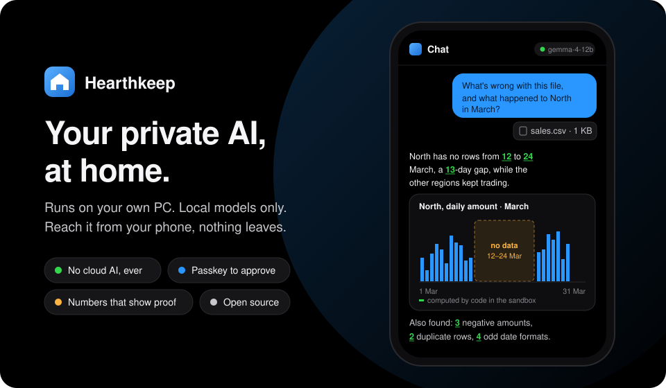
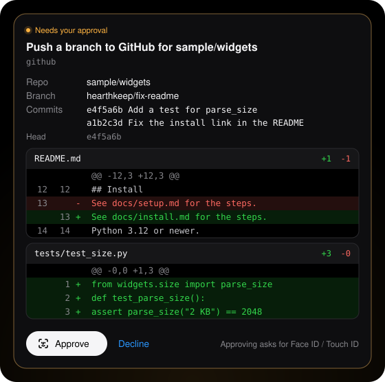
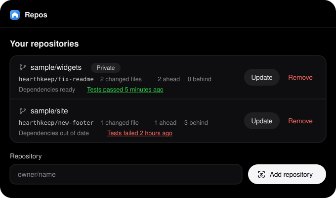
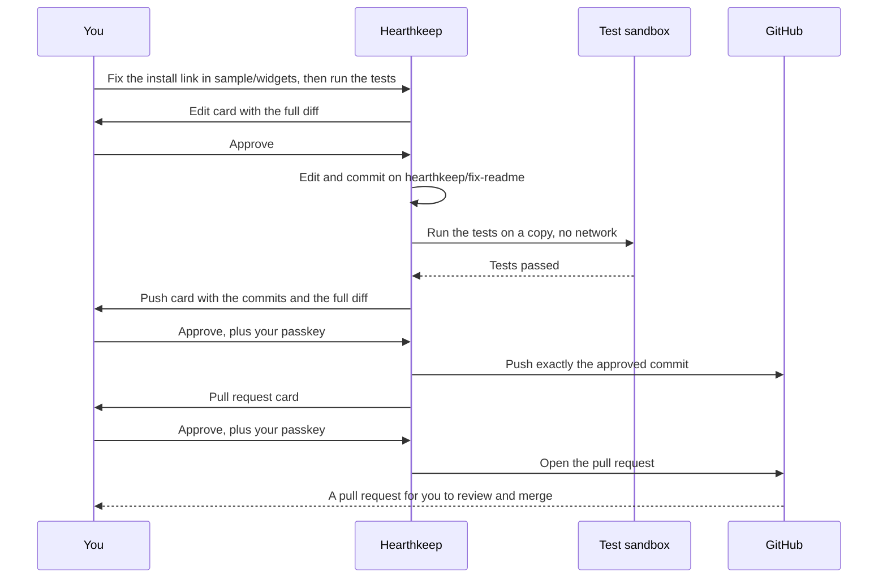
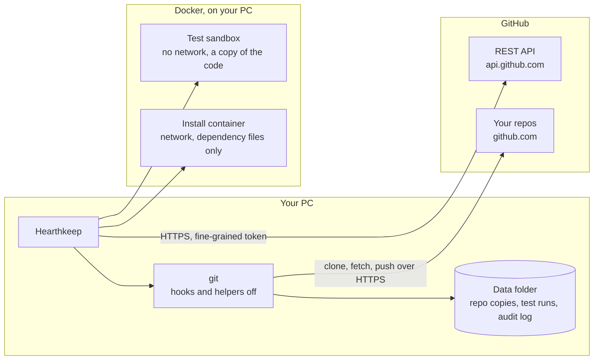
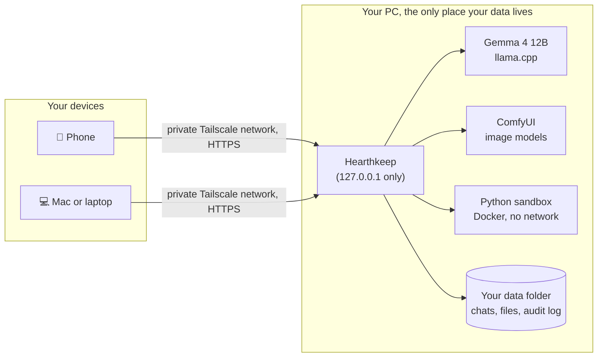
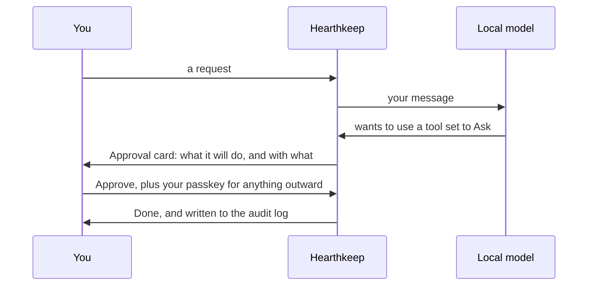

<p align="center">
  
</p>

<p align="center">
  <b>A personal AI assistant that lives on your own PC, not in someone else's cloud.</b><br>
  Local models. Your files stay home. You approve anything that matters, with a passkey.
</p>

<p align="center">
  <a href="LICENSE"></a>
  <a href="../../actions/workflows/ci.yml"></a>  
  
</p>

<p align="center">
  <a href="#why-hearthkeep">Why</a> ·
  <a href="#see-it-work">See it work</a> ·
  <a href="#what-you-can-do-with-it">Features</a> ·
  <a href="#work-on-your-code-safely">Your code</a> ·
  <a href="#how-it-fits-together">How it fits</a> ·
  <a href="#safety-you-can-check">Safety</a> ·
  <a href="#is-it-for-you">Is it for you?</a> ·
  <a href="#quick-start">Quick start</a> ·
  <a href="#roadmap">Roadmap</a> ·
  <a href="#documentation">Docs</a>
</p>

---

## Why Hearthkeep

Cloud assistants are brilliant, but everything you ask them, and every file you give them, goes to someone else's servers. Hearthkeep is for the things you'd rather keep at home: your bank statements, your sales sheets, your notes, your photos, your code.

| | Typical cloud assistant | **Hearthkeep** |
|---|---|---|
| Where your chats and files go | The provider's servers | **Your own PC. Nowhere else.** |
| Which AI answers | Their model, their rules | **Models you chose and run yourself** |
| When it does something that matters | It just does it | **It asks first; you confirm with a passkey** |
| Numbers in an answer | You hope they're right | **Each one is marked: computed by code, read from a page, or unverified** |
| Changes to your code | Depends on the tool | **On its own branch; you see the diff and approve each push** |
| Reaching it from your phone | Over the internet | **Over your own private Tailscale network** |
| Monthly fee | Usually | **None. Open source, Apache 2.0** |

## See it work

Attach a spreadsheet and ask a plain question. Hearthkeep writes the Python itself, runs it in a locked-down sandbox on your PC, and answers in plain words. This is a real answer from the local Gemma 4 12B model (lightly shortened), on a test file with problems planted in it:

> **You:** What's wrong with this file, and what happened to North in March?
> *(sales.csv attached)*
>
> **Hearthkeep:** The file contains several data quality issues:
> - **Mixed date formats:** 4 rows use a different date format than the rest of the file.
> - **Negative values:** there are 3 instances of negative amounts.
> - **Duplicate records:** 2 rows are exact duplicates of previous entries.
>
> Regarding the **North** region in March, there is a **13-day gap** in data between 2025-03-12 and 2025-03-24 where no sales were recorded, despite data being present before and after this period.

Every number in that answer was computed by code in the sandbox, so the app underlines it in green. A number the model made up on its own would be flagged as unverified, in plain sight.

## What you can do with it

<table>
<tr>
<td width="50%" valign="top">

💬 **Chat**<br>
Talk to a local model (Gemma 4 12B through llama.cpp). Replies stream in, and every tool it uses is shown step by step.

</td>
<td width="50%" valign="top">

📊 **Understand your data**<br>
Attach CSV, Excel or PDF files, scanned pages included. Ask what's wrong, what's unusual, what the trend is. You get findings, interactive charts and the rows behind each finding.

</td>
</tr>
<tr>
<td valign="top">

🧮 **Trust the numbers**<br>
Each number is marked *computed*, *read from page N* or *unverified*. Mixed date formats and gaps in daily data are found for you.

</td>
<td valign="top">

🐙 **Work on your GitHub repos**<br>
Add repos you choose. The assistant reads them, edits them on a branch of its own and commits there. Pushing a branch or opening a pull request shows you the full diff and needs your passkey. It never pushes to your main branch.

</td>
</tr>
<tr>
<td valign="top">

🧪 **Run their tests safely**<br>
A repo's tests run in a Docker sandbox with no network, on a copy of the code. The Repos view shows each repo's branch, changes and last test run, with the full output.

</td>
<td valign="top">

🗂️ **Find your own files**<br>
Let it look inside folders you choose, OneDrive included. It finds a file and brings a copy into the chat. It never writes to your folders.

</td>
</tr>
<tr>
<td valign="top">

🎨 **Make and edit images**<br>
Z-Image Turbo for images with words in them, FLUX.2 klein for photos and edits. Attach a photo and ask for a change.

</td>
<td valign="top">

📱 **Send to your phone**<br>
Results land in a tray on your phone. The notification says only "A file is ready in Hearthkeep", never what's in it.

</td>
</tr>
<tr>
<td valign="top">

🖼️ **Galleries**<br>
An Images view and an Analysis view collect everything you've made, grouped by chat.

</td>
<td valign="top">

⚙️ **Settings that make sense**<br>
Devices with QR-code setup, allowed folders, your GitHub token, notifications and start at login, all in one place.

</td>
</tr>
</table>

## Work on your code, safely

Ask in chat, for example: *"In sample/widgets, fix the install link in the README and run the tests."* The assistant works in a copy of the repo on your PC, only on branches named `hearthkeep/<name>`. Nothing reaches GitHub until you approve it, and every card shows exactly what will change.

<table>
<tr>
<td width="50%" valign="top" align="center">
  
  <br><sub><b>A push waits for you.</b> The card lists the commits and shows the full diff. Approve asks for your passkey, and the push sends exactly that commit.</sub>
</td>
<td width="50%" valign="top" align="center">
  
  <br><sub><b>The Repos view.</b> Each repo's branch, changes, dependencies and last test run. Select a run to read its full output.</sub>
</td>
</tr>
</table>

From request to pull request:



What runs where:



- **You choose the repos.** A fine-grained token for only the repos you pick, saved in Settings with your passkey. Classic tokens are refused.
- **Edits stay local** until you approve a push. Editing and committing are *Change local*; pushing, opening a pull request, commenting, merging and closing are *Outward*.
- **Tests never run on your PC itself.** They run in a second sandbox image with no network, 4 GB of memory, 2 CPUs and a 10 minute limit, on a copy of the code without `.git`.
- **Installing dependencies** (`uv`, `pip` or `npm`) is approved once per lock file, with a passkey, because the install container has full network access. It sees only the dependency files, never your token or your other files.

Setup is in [docs/install.md, step 12](docs/install.md#12-optional-github). The full rules are in [docs/security.md](docs/security.md#github).

## How it fits together



The models, the sandbox and your data never face the internet. Hearthkeep listens only on your own machine, and your other devices reach it through Tailscale's private network, never through an open port. Once you save a GitHub token, Hearthkeep also talks to GitHub over HTTPS, to `api.github.com` and `github.com` only.

## Safety you can check

Every action the assistant takes falls into one of three layers. The further it reaches, the more it asks of you:

<p align="center">
  
</p>

The assistant can suggest anything, but a tool you've set to **Ask**, or anything that would leave your PC, waits for you:



| Action class | Allowed | Ask | Off |
|---|---|---|---|
| **Look**: reads or looks something up | Runs | Asks you | Blocked |
| **Change local**: changes something on this PC | Asks you the first time in a chat, then runs for that chat | Asks you every time | Blocked |
| **Outward**: anything that leaves the PC | Asks you, with your passkey | Asks you, with your passkey | Blocked |

GitHub and GitHub tests start at **Ask**.

<details>
<summary><b>Every safety rule, in short</b></summary>

- **No passwords.** You sign in with a passkey: Face ID, Touch ID, Windows Hello or a PIN.
- **Every tool is Allowed, Ask or Off**, and you decide which. Anything outward-facing always needs an approval plus a fresh passkey check.
- **Deleting and widening access need a passkey too**, bound to that exact chat, file, folder or repo.
- **GitHub is opt-in and narrow.** A fine-grained token for the repos you pick. The assistant works on branches named `hearthkeep/<name>`, never pushes to your main branch, and a push sends exactly the commit on the approval card.
- **The Python sandbox** has no network, a read-only view of your files, no privileges, and hard limits on memory, CPU and time. Every run is saved so you can read the script.
- **A repo's tests** run in a second sandbox: no network, a copy of the code without `.git`, and a 10 minute limit. A test can't reach your copy of the repo.
- **An audit log** records sign-ins, approvals and changes. The app can read it but has no way to edit it.
- **Secrets are encrypted** with a key held in your operating system's keyring, and never shown to the model. The GitHub token never appears in a command line, a container, a log or anything the model sees.
- **Nothing personal in this repository**, ever. A privacy scanner checks every commit.

</details>

The full security model is in [docs/security.md](docs/security.md).

## Is it for you?

Hearthkeep is early software. It's a good fit if you:

- have a **Windows 11 PC with an NVIDIA GPU** (about 16 GB of VRAM for the shipped models),
- are happy to follow a step-by-step guide to add the models and reach it from your phone,
- want an assistant you can use from your phone without your data leaving home.

<details>
<summary><b>Requirements</b></summary>

| | Needed |
|---|---|
| OS | Windows 11 (the tested host). macOS and Linux work as clients; as a host they are untested. |
| GPU | NVIDIA, about 16 GB VRAM for the shipped models |
| RAM | 32 GB recommended |
| Disk | About 60 GB for the shipped models and tools |
| Software | Git 2.31+, Python 3.12+, [uv](https://docs.astral.sh/uv/), Node 20.19+ or 22.12+, [Docker Desktop](https://www.docker.com/products/docker-desktop/) for Python analysis and repo tests, [Tailscale](https://tailscale.com) for remote access |

Git 2.31 or newer is also what turns the GitHub tools on: without it, they are not offered.

</details>

No suitable GPU? You can point Hearthkeep at an OpenAI-compatible chat server you already run on the same PC. Image generation is then off.

## Quick start

On Windows 11:

1. Download the Hearthkeep zip from the [latest release](../../releases/latest).
2. Unzip it to a short path, for example `C:\Hearthkeep\app`.
3. Double-click `Setup.cmd`.

Setup installs what it needs for your Windows account (no admin rights), starts Hearthkeep and opens it in your browser, where you create your passkey. Afterwards, open Hearthkeep from the Start menu.

The full guide, including model downloads, Docker, Tailscale and GitHub, is in **[docs/install.md](docs/install.md)**.

### Developers

To build from source, see [CONTRIBUTING.md](CONTRIBUTING.md). In short:

```
git clone <repository URL> hearthkeep
cd hearthkeep/web
npm ci
npm run build
cd ../server
uv sync
uv run hearthkeep sandbox build --data <data>
uv run hearthkeep serve --data <data>
```

`<data>` is a folder of your choice outside the repository. `sandbox build` builds two Docker images: `hearthkeep-sandbox` for Python analysis and `hearthkeep-repo` for a GitHub repo's tests and dependencies. Open `http://localhost:8765`, enter the enrollment code the server printed, and create your passkey. Decide on remote access **before** you create it: a passkey made on `localhost` does not work on your Tailscale address. See [Decide on remote access](docs/install.md#7-decide-on-remote-access-before-your-first-passkey).

To work on GitHub repos, make a fine-grained token and add your repos: [Optional: GitHub](docs/install.md#12-optional-github).

## Roadmap

| Phase | Delivers | Status |
|---|---|---|
| 1. Secure core | Passkeys, permissions and approvals, audit log, secrets, chat | ✅ Done |
| 2. Models and images | Model cards, GPU switching, image generation, photo editing, Images view | ✅ Done |
| 3. Files and analysis | Chat files, allowed folders, Python sandbox, number check, Analysis view, send to your phone, Devices and Settings, start at login | ✅ Done |
| 4. GitHub | Your repos, sandboxed tests, approved pushes and pull requests | ✅ Done |
| 5. Demos and launch | Demo data, screenshots and clips, getting started in minutes | Planned |
| 6. Feature switches and model catalog | Choose features at install and in Settings (off means the AI can't reach them); a catalog that checks whether a model fits your PC, and room for your own models | Planned |
| 7. Voice | Replies read aloud with local voices (Chatterbox, with Kokoro as a fallback) | Planned |
| 8. 3D | A picture or a prompt in, a 3D model out (GLB, OBJ, FBX), straight into Blender if you like | Planned |

A daily briefing and a one-command installer are planned too; their place in the order is still open. The design behind each phase is in [docs/design.md](docs/design.md), and each phase is built from a written plan in [docs/superpowers/plans/](docs/superpowers/plans/).

## Documentation

| Guide | What's in it |
|---|---|
| [docs/install.md](docs/install.md) | Installation, Docker, GitHub, Tailscale, notifications, start at login, updates, backups, troubleshooting |
| [docs/models.md](docs/models.md) | Model cards, `models.toml`, GPU switching and images |
| [docs/security.md](docs/security.md) | The security model and what the assistant can never do |
| [docs/design.md](docs/design.md) | The design |
| [docs/README.md](docs/README.md) | Index of all docs |

## Contributing

Contributions are welcome. Read [CONTRIBUTING.md](CONTRIBUTING.md) first: the one hard rule is that nothing personal ever goes into the repository.

## Reporting a security issue

Please report vulnerabilities privately, not in a public issue. See [SECURITY.md](SECURITY.md).

## License

Apache 2.0. See [LICENSE](LICENSE).
