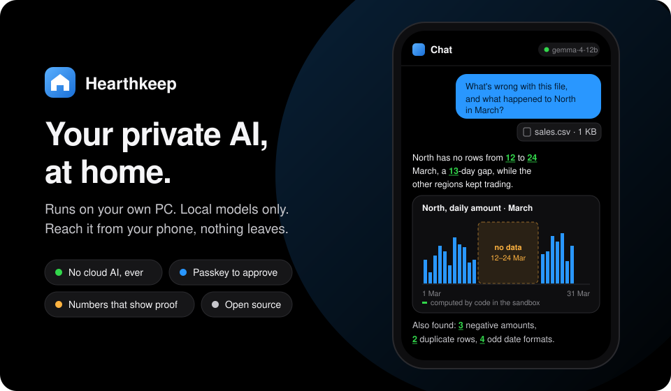
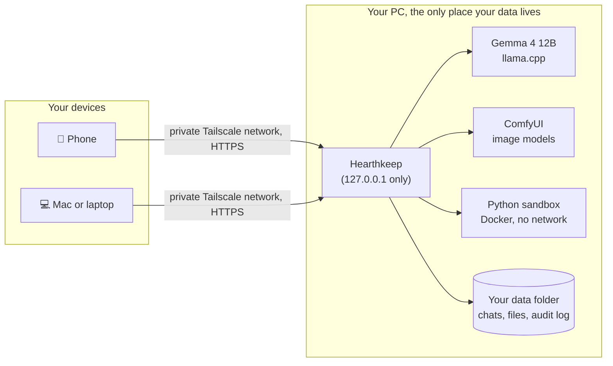
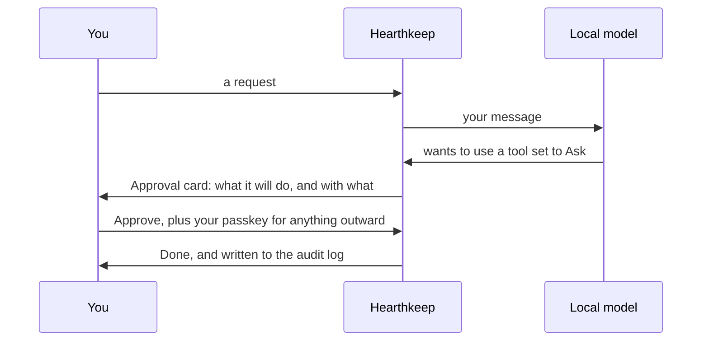

<p align="center">
  
</p>

<p align="center">
  <b>A personal AI assistant that lives on your own PC, not in someone else's cloud.</b><br>
  Local models. Your files stay home. You approve anything that matters, with a passkey.
</p>

<p align="center">
  <a href="LICENSE"></a>
  <a href="../../actions/workflows/ci.yml"></a>
  
  
</p>

---

## Why Hearthkeep

Cloud assistants are brilliant, but everything you ask them, and every file you give them, goes to someone else's servers. Hearthkeep is for the things you'd rather keep at home: your bank statements, your sales sheets, your notes, your photos.

| | Typical cloud assistant | **Hearthkeep** |
|---|---|---|
| Where your chats and files go | The provider's servers | **Your own PC. Nowhere else.** |
| Which AI answers | Their model, their rules | **Models you chose and run yourself** |
| When it does something that matters | It just does it | **It asks first; you confirm with a passkey** |
| Numbers in an answer | You hope they're right | **Each one is marked: computed by code, read from a page, or unverified** |
| Reaching it from your phone | Over the internet | **Over your own private Tailscale network** |
| Monthly fee | Usually | **None. Open source, Apache 2.0** |

## See it work

Attach a spreadsheet and ask a plain question. Hearthkeep writes the Python itself, runs it in a locked-down sandbox on your PC, and answers in plain words. This is a real answer from the local Gemma 4 12B model (lightly shortened), on a test file with problems planted in it:

> **You:** What's wrong with this file, and what happened to North in March?
> *(sales.csv attached)*
>
> **Hearthkeep:** The file contains several data quality issues:
> - **Mixed date formats:** 4 rows use a different date format than the rest of the file.
> - **Negative values:** there are 3 instances of negative amounts.
> - **Duplicate records:** 2 rows are exact duplicates of previous entries.
>
> Regarding the **North** region in March, there is a **13-day gap** in data between 2025-03-12 and 2025-03-24 where no sales were recorded, despite data being present before and after this period.

Every number in that answer was computed by code in the sandbox, so the app underlines it in green. A number the model made up on its own would be flagged as unverified, in plain sight.

## What you can do with it

| | |
|---|---|
| 💬 **Chat** | Talk to a local model (Gemma 4 12B through llama.cpp). Replies stream in, and every tool it uses is shown step by step. |
| 📊 **Understand your data** | Attach CSV, Excel or PDF files, scanned pages included. Ask what's wrong, what's unusual, what the trend is. You get findings, interactive charts and the rows behind each finding. |
| 🧮 **Trust the numbers** | Each number is marked *computed*, *read from page N* or *unverified*. Mixed date formats and gaps in daily data are found for you. |
| 🗂️ **Find your own files** | Let it look inside folders you choose, OneDrive included. It finds a file and brings a copy into the chat. It never writes to your folders. |
| 🎨 **Make and edit images** | Z-Image Turbo for images with words in them, FLUX.2 klein for photos and edits. Attach a photo and ask for a change. |
| 📱 **Send to your phone** | Results land in a tray on your phone. The notification says only "A file is ready in Hearthkeep", never what's in it. |
| 🖼️ **Galleries** | An Images view and an Analysis view collect everything you've made, grouped by chat. |
| ⚙️ **Settings that make sense** | Devices with QR-code setup, allowed folders, notifications and start at login, all in one place. |

## How it fits together



The models, the sandbox and your data never face the internet. Hearthkeep listens only on your own machine, and your other devices reach it through Tailscale's private network, never through an open port.

## Safety you can check

The assistant can suggest anything, but a tool you've set to **Ask**, or anything that would leave your PC, waits for you:



- **No passwords.** You sign in with a passkey: Face ID, Touch ID, Windows Hello or a PIN.
- **Every tool is Allowed, Ask or Off**, and you decide which. Anything outward-facing always needs an approval plus a fresh passkey check.
- **Deleting and widening access need a passkey too**, bound to that exact chat, file or folder.
- **The Python sandbox** has no network, a read-only view of your files, no privileges, and hard limits on memory, CPU and time. Every run is saved so you can read the script.
- **An audit log** records sign-ins, approvals and changes. The app can read it but has no way to edit it.
- **Secrets are encrypted** with a key held in your operating system's keyring, and never shown to the model.
- **Nothing personal in this repository**, ever. A privacy scanner checks every commit.

The full security model is in [docs/security.md](docs/security.md).

## Is it for you?

Hearthkeep is early software. It's a good fit if you:

- have a **Windows 11 PC with an NVIDIA GPU** (about 16 GB of VRAM for the shipped models),
- are comfortable running a few commands in a terminal,
- want an assistant you can use from your phone without your data leaving home.

| | Needed |
|---|---|
| OS | Windows 11 (the tested host). macOS and Linux work as clients; as a host they are untested. |
| GPU | NVIDIA, about 16 GB VRAM for the shipped models |
| RAM | 32 GB recommended |
| Disk | About 60 GB for the shipped models and tools |
| Software | Git, Python 3.12+, [uv](https://docs.astral.sh/uv/), Node 20.19+ or 22.12+, [Docker Desktop](https://www.docker.com/products/docker-desktop/) for Python analysis, [Tailscale](https://tailscale.com) for remote access |

No suitable GPU? You can point Hearthkeep at an OpenAI-compatible chat server you already run on the same PC. Image generation is then off.

## Quick start

The full step-by-step guide, including model downloads, Docker and Tailscale, is in **[docs/install.md](docs/install.md)**. In short:

```
git clone <repository URL> hearthkeep
cd hearthkeep/web
npm ci
npm run build
cd ../server
uv sync
uv run hearthkeep sandbox build --data <data>
uv run hearthkeep serve --data <data>
```

`<data>` is a folder of your choice outside the repository. Open `http://localhost:8765`, enter the enrollment code the server printed, and create your passkey. Decide on remote access **before** you create it: a passkey made on `localhost` does not work on your Tailscale address. See [Decide on remote access](docs/install.md#7-decide-on-remote-access-before-your-first-passkey).

## Roadmap

| Phase | Delivers | Status |
|---|---|---|
| 1. Secure core | Passkeys, permissions and approvals, audit log, secrets, chat | ✅ Done |
| 2. Models and images | Model cards, GPU switching, image generation, photo editing, Images view | ✅ Done |
| 3. Files and analysis | Chat files, allowed folders, Python sandbox, number check, Analysis view, send to your phone, Devices and Settings, start at login | ✅ Done |
| 4. GitHub | Your repos, sandboxed tests, approved pushes and pull requests | Next |
| 5. Demos and launch | Demo data, screenshots and clips, getting started in minutes | Planned |
| 6. Feature switches and model catalog | Choose features at install and in Settings (off means the AI can't reach them); a catalog that checks whether a model fits your PC, and room for your own models | Planned |
| 7. Voice | Replies read aloud with local voices (Chatterbox, with Kokoro as a fallback) | Planned |
| 8. 3D | A picture or a prompt in, a 3D model out (GLB, OBJ, FBX), straight into Blender if you like | Planned |

A daily briefing and a one-command installer are planned too; their place in the order is still open. The design behind each phase is in [docs/design.md](docs/design.md), and each phase is built from a written plan in [docs/superpowers/plans/](docs/superpowers/plans/).

## Documentation

- [docs/install.md](docs/install.md): installation, Docker, Tailscale, notifications, start at login, updates, backups, troubleshooting
- [docs/models.md](docs/models.md): model cards, `models.toml`, GPU switching and images
- [docs/security.md](docs/security.md): the security model and what the assistant can never do
- [docs/design.md](docs/design.md): the design
- [docs/README.md](docs/README.md): index of all docs

## Contributing

Contributions are welcome. Read [CONTRIBUTING.md](CONTRIBUTING.md) first: the one hard rule is that nothing personal ever goes into the repository.

## Reporting a security issue

Please report vulnerabilities privately, not in a public issue. See [SECURITY.md](SECURITY.md).

## License

Apache 2.0. See [LICENSE](LICENSE).
